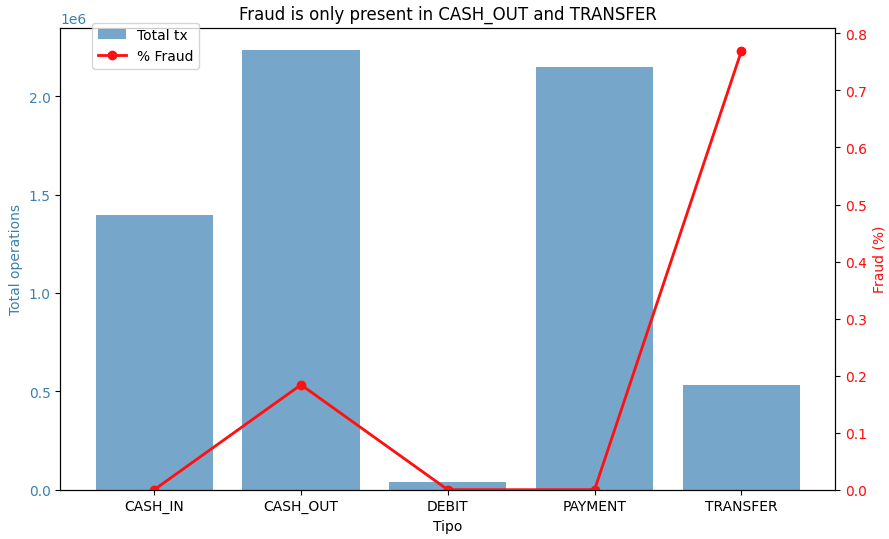
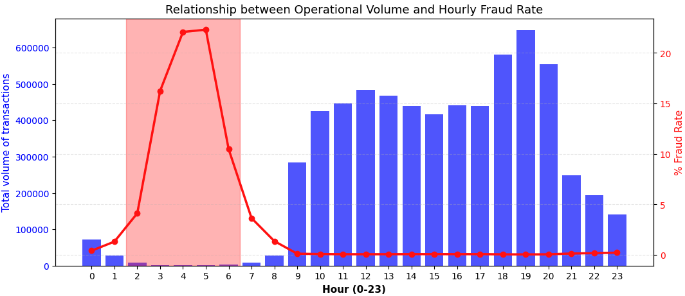
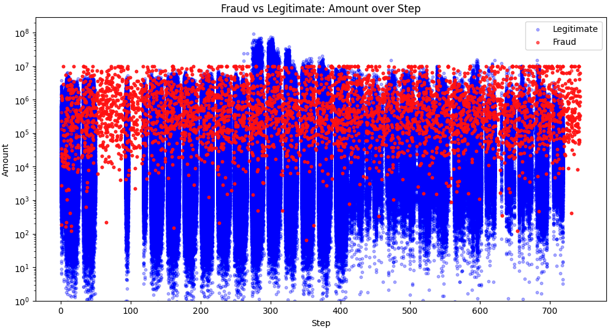
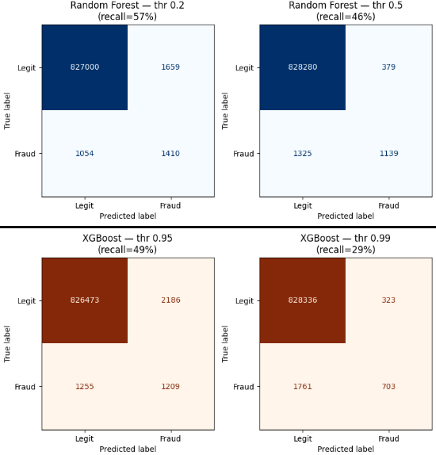
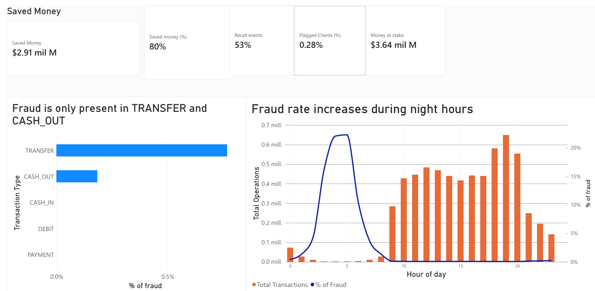
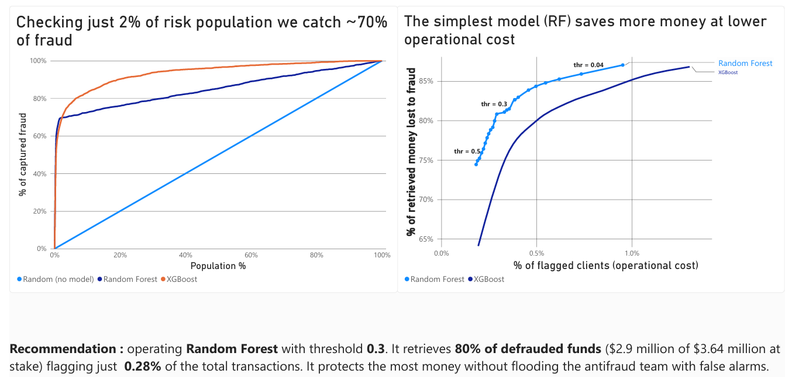
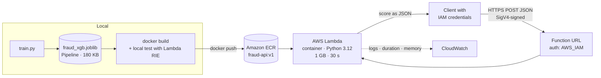
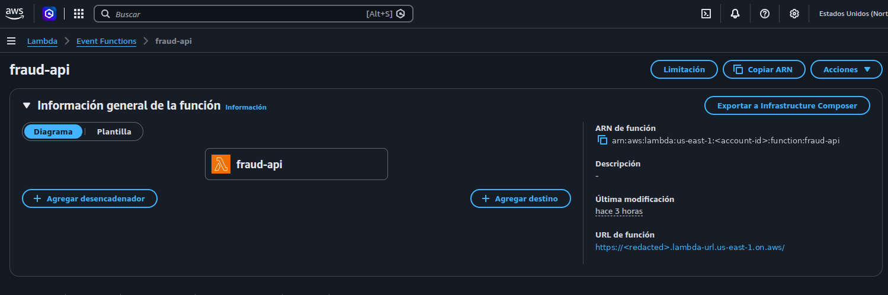
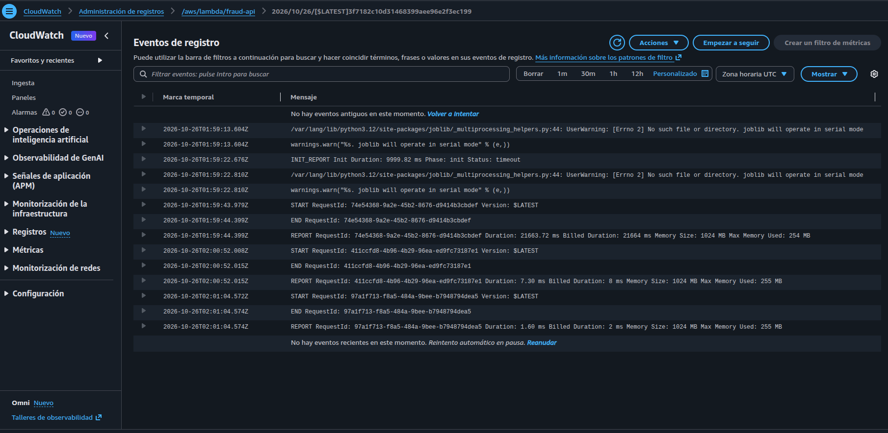

# Transactional Fraud Detection — from SQL EDA to a live API on AWS

   

> **Deployed:** the model runs as a **containerized, serverless REST API on AWS**: a Docker image in **Amazon ECR**, served by **AWS Lambda** behind a private, **IAM-authenticated** HTTPS endpoint, with logs and latency in **CloudWatch** and no long-lived access keys anywhere. ~7 ms warm inference, $0 operating cost. → [Part 3](#part-3--deployment-on-aws-the-model-as-a-live-api)

**Business question:** How can we accurately identify fraudulent mobile-money transactions in a large dataset (6 million records), minimizing financial losses?

Built on ~6.36 million simulated mobile-money transactions (PaySim1, Kaggle). The emphasis here is **identifying behavioral patterns through SQL-based exploratory data analysis (EDA)** and **preventing target leakage** to build a robust machine learning model. The full pipeline: `SQL EDA` -> `Python EDA` -> `PostgreSQL Connection` -> `Model Training & Evaluation` -> `Stakeholder Dashboard (Power BI)` -> `Containerized API on AWS Lambda`.

---
## Data Dictionary

| Variable | Description | Type |
|---|---|---|
| `isFraud` | **Target.** 1 if the transaction is actual fraud, 0 otherwise | integer |
| `step` | Time unit. 1 step = 1 hour. The dataset simulates ~30 days (744 steps) | integer |
| `type` | Transaction type: `CASH_IN`, `CASH_OUT`, `TRANSFER`, `PAYMENT`, `DEBIT` | string |
| `amount` | Transaction amount | float |
| `nameOrig` | Originating customer | string |
| `oldbalanceOrg` | Origin account balance before the transaction | float |
| `newbalanceOrig` | Origin account balance after the transaction | float |
| `nameDest` | Destination customer/merchant | string |
| `oldbalanceDest` | Destination account balance before the transaction | float |
| `newbalanceDest` | Destination account balance after the transaction | float |
| `isFlaggedFraud` | Simulator's internal anti-fraud flag (marks transfers > 200,000) | integer |

*Source: "PaySim1", Kaggle.*

**Note: Balance columns were strictly excluded from the final model to prevent target leakage (see findings below).**

## The Headline for the Business

**The trained model successfully captures ~80% of potentially lost-to-fraud money while catching only 53% of fraud events — by prioritizing high-value fraud (money, not event count)** With a ROC-AUC of 0.8451 and a PR-AUC of 0.5425 on highly imbalanced data, the model efficiently separates fraudulent actions from legitimate volume. This can be increased depending on the business ability of dealing with false positives (transactions incorrectly flagged as fraud).

---

## Why the Data Work is the Point

Every cleaning and feature engineering decision was made by querying the raw data in PostgreSQL to uncover mechanisms of fraud. Rare is not the same as wrong, but identifying data generation mechanics is key to avoiding over-optimistic models.

### Finding 1 — Fraud is highly concentrated by transaction type



Fraud is strictly present in only two transaction types: `TRANSFER` (0.77% fraud rate) and `CASH_OUT` (0.18% fraud rate). `TRANSFER` is 4 times riskier. No other type contained any fraud. 
**Action:** The dataset was filtered to train only on `TRANSFER` and `CASH_OUT` to simplify the model with zero loss of fraud examples.

### Finding 2 — A cyclical temporal pattern exposes fraud hours



While the absolute number of fraudulent transactions is roughly constant throughout the day, the *rate* of fraud spikes drastically during low-activity hours (hours 2-6, relative to the simulation start). The fraud rate surges from ~0.06% during peak hours to up to 22% during these "night" hours. 
**Action:** Engineered a new binary feature `is_night`.

### Finding 3 — Target leakage in account balances

An analysis of the balance columns (`oldbalanceOrg` - `amount` vs `newbalanceOrig`) revealed severe target leakage. For legitimate transactions, the math mostly reconciles. However, fraudulent rows show massive balance "errors" (e.g., median error of 399k vs 164k). According to PaySim documentation, balances are altered after a fraud is cancelled. 
**Action:** Excluded all balance columns from the model to prevent it from simply learning the leakage. 

### Finding 4 — The built-in rule is useless

The simulator's built-in `isFlaggedFraud` rule (which flags any `TRANSFER` > 200,000) catches almost no real fraud. This mathematically confirms the need for an advanced machine learning approach over simple heuristics.

### Finding 5 — Customers vs Merchants

Every fraudulent transaction occurs between two Customer accounts (starting with 'C'). Merchants (starting with 'M') are never the origin or destination of fraud in this dataset. Furthermore, destination "mule" accounts are virtually single-use. 

### Finding 6 — Amount vs Step has signal

 

 Consistent with Finding 2, fraud transactions distributions tend to be pretty stochastic in the step dimension, however in amount, they are mostly bounded [10^4-10^7].

---

## Feature Engineering & Model Training

Based on the EDA, the final feature set was intentionally kept small, robust, and LEAKAGE-FREE:
- `amount` (strong legitimate signal)
- `type` (TRANSFER or CASH_OUT)
- `step`
- `hour_of_day` (extracted as `step % 24`)
- `is_night` (flag for hours 2-6)

### Model Training Strategy
Because the dataset is heavily imbalanced (fraud represents < 0.2% of transactions), standard accuracy is misleading. The model was trained and evaluated using **PR-AUC (Precision-Recall Area Under Curve)** over ROC-AUC, as PR-AUC is more sensitive to improvements in the minority (fraud) class. 

### Threshold Tuning & Business Impact
A standard machine learning classification threshold (0.5) is rarely optimal for real-world fraud detection. By evaluating the model's probabilities, we can adjust the decision threshold to align with the business's risk tolerance:

- **High Threshold (Conservative):** Prioritizes Precision. Catches less fraud, but ensures almost no legitimate customers are blocked (low false positives).
- **Optimized Threshold (Business-driven):** By lowering the threshold, we increase Recall, successfully capturing **~80% of potentially lost-to-fraud money**. The trade-off is an increase in false positives (legitimate transactions flagged as fraud), which would need to be handled via friction (e.g., 2FA prompts) or manual review queues.

**Confusion Matrices: Default vs. Business-Tuned Threshold**

*(Below, you can see how adjusting the threshold impacts the raw number of caught fraud vs. false alerts for the two ML models evaluated: RF vs XGBoost)*



**Performance Highlights:**
**Business Favored Model recommendation: Random Forest with 0.3-0.1 threshold**
- **ROC-AUC:** 0.8451
- **PR-AUC:** 0.5425
- **Money saved:** 80%-84.3%
---

## Repo

```
fraud-detection/
├── README.md
├── fraud_detection_eda_and_fe.sql  # PostgreSQL EDA and Feature Engineering
├── Fraud_detection.ipynb           # Python EDA, DB connection, Modeling
├── figures/
├── powerbi/                        # Part 2: dashboard (.pbix + screenshots)
└── deploy/                         # Part 3: the model as a serverless API on AWS
    ├── features.py                 # one feature definition, shared by training and serving
    ├── train.py                    # trains and saves the scikit-learn Pipeline
    ├── predict.py                  # input validation + scoring contract
    ├── app.py                      # AWS Lambda handler
    ├── test_predict.py             # pytest contract tests
    ├── Dockerfile                  # AWS Lambda Python 3.12 base image
    ├── requirements.txt            # serving dependencies (pinned)
    ├── requirements-dev.txt        # + training and testing
    ├── model/fraud_xgb.joblib      # trained Pipeline (180 KB)
    └── screenshots/
```

**Data:** Not committed due to size limits. Download from the [Kaggle competition](https://www.kaggle.com/datasets/ealaxi/paysim1) or via `kagglehub`. Cite: E. A. Lopez-Rojas , A. Elmir, and S. Axelsson. "PaySim: A financial mobile money simulator for fraud detection". In: The 28th European Modeling and Simulation Symposium-EMSS, Larnaca, Cyprus. 2016

## Requirements
- Analysis (Part 1): Python 3.8+, pandas, numpy, scikit-learn, xgboost, matplotlib, seaborn, psycopg2
- Deployment (Part 3): Python 3.12, Docker, AWS CLI v2; pinned versions in `deploy/requirements.txt`

---

# Part 2 — Stakeholder Dashboard (Power BI)

Part 1 proves the model works. Part 2 answers a different question: **can a non-technical fraud-risk stakeholder see the value and act on it?** This layer translates the model output into an operating decision, built on four pre-aggregated tables exported from the notebook — no row-level data, no leakage columns.

> The `.pbix` is included. The screenshots below are the deliverable.

## Page 1 — Monitoring: impact → where → when



The header asserts a single operating point (Random Forest @ threshold 0.30): **$3.64B at stake → 80% of the money recovered, catching only 53% of fraud *events*, while flagging just 0.28% of clients.** The model is optimized for money, not event count — it prioritizes the expensive frauds. The lower visuals justify the modeling scope (fraud lives only in TRANSFER and CASH_OUT) and the `is_night` feature (fraud rate spikes overnight while volume collapses).

## Page 2 — Decision analysis: which model, which threshold



**Trade-off curve (right):** money saved vs. % of clients flagged, one line per model. The x-axis is **operational cost (flagged %), not the raw threshold** — the only honest way to compare RF and XGBoost, whose probability scales differ (XGBoost uses another scale, so an identical threshold means different things per model). Compared at equal cost, **RF dominates across the entire realistic operating region (≤2% flagged).** The curve is cropped to that region on purpose: XGBoost only "wins" further right by flagging 5–8% of clients — a cost no antifraud team pays (Remember the total number of test set transactions is on the hundreds of thousands). Threshold labels (0.5 / 0.3 / 0.04) make the operating point explicit.

**Gains curve (left):** if the review team can only inspect a fraction of transactions, ranking by model score and reviewing the top ~2% captures ~70% of fraud *events*. The "Random (no model)" diagonal is the baseline — the gap above it is the model's lift.

## What these two charts show *together* (the core insight)

The gains curve shows **XGBoost catching slightly more fraud events** in the top 2%; the trade-off curve shows **RF saving more money** at equal cost. XGBoost catches more *cases*; RF catches more *dollars*, because it ranks high-value frauds higher. **This result is the reason this project optimizes for money saved rather than event-count recall, a real business decision.** A model tuned to maximize caught-fraud *count* would recommend XGBoost and increase operational cost by flagging ~10^4 legitimate transactions for review.

## On the tool

For a static, single-analyst portfolio, Power BI is included to demonstrate the communication layer: turning a defensible model into an operating recommendation a risk stakeholder can act on.

---

# Part 3 — Deployment on AWS: the model as a live API

Part 1 proves the model works; Part 2 makes it actionable for a stakeholder. Part 3 answers the engineering question: **can another system call it in real time, securely and at zero cost?** The trained scikit-learn Pipeline is packaged in a Docker image and served by AWS Lambda behind a private HTTPS endpoint.

## Architecture



## Call it

The endpoint only accepts requests signed with IAM credentials of the account (SigV4); anything else gets `403`.

```bash
eval "$(aws configure export-credentials --format env)"   # short-lived credentials from `aws login`
curl -X POST "$FRAUD_API_URL" \
  --aws-sigv4 "aws:amz:us-east-1:lambda" \
  --user "$AWS_ACCESS_KEY_ID:$AWS_SECRET_ACCESS_KEY" \
  -H "x-amz-security-token: $AWS_SESSION_TOKEN" \
  -H "Content-Type: application/json" \
  -d '{"step": 26, "type": "TRANSFER", "amount": 500000.0}'
# 200 -> {"fraud_score": 0.9787, "is_fraud": true}
```

| | |
|---|---|
| **Input** | `step` (simulation hour), `type` (`TRANSFER` or `CASH_OUT`), `amount` (≥ 0) |
| **Output** | `fraud_score` (probability, 0–1) and `is_fraud` (`fraud_score ≥ 0.9`) |
| **Errors** | `400` with a message for an unsupported `type`, a missing field, a negative amount or invalid JSON; `403` for unsigned or unauthorized requests |

## Design decisions

| Decision | Why |
|---|---|
| Features computed inside the Pipeline (`FunctionTransformer(add_features)`), from one `features.py` shared by training and serving | The API receives raw fields and computes features exactly as in training, so there is no training/serving skew. Verified: the same score (0.9787) on the laptop, in local Docker and on Lambda. |
| XGBoost as the served model | Small artifact (180 KB) keeps the image lean and the cold start shorter. Trade-off: Part 1's Random Forest ranks better (PR-AUC 0.5425 vs 0.4283); swapping it in is a one-line change in `train.py`. |
| Threshold 0.9 | On XGBoost's probability scale (see Part 2), it saves 83.8% of defrauded money while flagging 0.85% of transactions. |
| Validate before scoring | The model only saw `TRANSFER` and `CASH_OUT`; anything else gets a `400` instead of a meaningless score. |
| Model loaded once per container | Loaded at import (Lambda init) and reused by every warm request. |
| Container image instead of a .zip | pandas + scikit-learn + XGBoost exceed Lambda's 250 MB unzipped .zip limit; container images can be up to 10 GB. |
| Private endpoint (Function URL with `AWS_IAM` auth) | Only IAM identities of this account can call it; unsigned traffic is rejected with `403` before the function code runs, so the URL is useless to anyone else. |
| Security | Root account locked behind MFA; daily work as an IAM user; the CLI uses `aws login` short-lived credentials (no access keys anywhere); the function's execution role can only write its own logs; ECR scans the image on push. |
| Cost guardrails | AWS Free plan, a zero-spend budget and a cost anomaly monitor, single region (us-east-1). Reserved concurrency can't be set on a new account (limit 10, and AWS keeps ≥ 100 unreserved), so the account limit caps worst-case traffic. |

## Results in production (CloudWatch)

| Metric | Value |
|---|---|
| Warm inference (server side) | 7.3 ms (a rejected request: 1.6 ms) |
| Warm round trip from Mexico (curl) | ~0.3 s, mostly network + TLS |
| Cold start (first call after deploy) | ~32 s: loading the freshly pulled image exceeded Lambda's 10 s init limit, so Lambda retried the init inside the first request (21.7 s) |
| Cold start (image already cached) | ~5 s end to end (init 4.3 s) |
| Memory used | 255 MB of 1,024 MB |
| Image | 880 MB local, 301 MB compressed in ECR |
| Cost | $0 |





## Limitations & next steps

- **`step` is an absolute hour of the simulation (1–743).** Live traffic would bring hours the model never saw; a production version should keep only cyclical time features (`hour_of_day`, `is_night`).
- **Random train/test split.** Test rows come from the same weeks as training, so this is not an out-of-time evaluation; a temporal split is the next validation step.
- **Cold start.** Slimmer image (e.g., drop pandas from serving) or more memory (Lambda allocates more CPU with more memory).
- **Callers outside the account.** External clients would need a dedicated IAM role, or API Gateway with keys and throttling.
- **No monitoring or retraining yet.** Next: replay the test set week by week through the API and track alert rate, precision and money caught in CloudWatch.
- **Image vulnerabilities.** ECR's scan reports 19 HIGH findings, all in OS packages of the AWS base image (curl, openssl, rpm, …), none in the Python dependencies. Fix: rebuild on the latest base image.
- **Infrastructure built by hand.** Next: AWS SAM (infrastructure as code) and GitHub Actions (CI/CD).

<details>
<summary><b>Reproduce it</b></summary>

```bash
cd deploy
python3.12 -m venv .venv && .venv/bin/pip install -r requirements-dev.txt
.venv/bin/python train.py      # downloads PaySim via kagglehub, trains, saves model/fraud_xgb.joblib
.venv/bin/pytest -v            # API contract tests

# Run Lambda locally (the base image ships the Runtime Interface Emulator)
docker build -t fraud-api .
docker run --rm -p 9000:8080 fraud-api
curl -X POST localhost:9000/2015-03-31/functions/function/invocations \
  -d '{"body": "{\"step\": 26, \"type\": \"TRANSFER\", \"amount\": 500000.0}"}'

# Push to Amazon ECR (ACCOUNT = your AWS account id)
aws login
aws ecr create-repository --repository-name fraud-api --image-scanning-configuration scanOnPush=true
aws ecr get-login-password --region us-east-1 | docker login --username AWS --password-stdin ACCOUNT.dkr.ecr.us-east-1.amazonaws.com
docker tag fraud-api:latest ACCOUNT.dkr.ecr.us-east-1.amazonaws.com/fraud-api:v1
docker push ACCOUNT.dkr.ecr.us-east-1.amazonaws.com/fraud-api:v1
```

Then, in the Lambda console: *Create function → Container image* (x86_64, 1,024 MB, 30 s timeout) → *Configuration → Function URL* (auth `AWS_IAM`).

</details>
